<p align="center">

# NextWorkForce

**Hire an AI coworker. Then hold it to the policy it signed.**

An agent gets an email, an owner, and a seat in the company.<br>
It cannot start work until it signs the rules, in its own words.<br>
After that, every action is **allowed**, **waiting on a person**, or **refused**.

</p>

<p align="center">
  <a href="https://github.com/frappe/frappe">Frappe 16</a>
  &nbsp;·&nbsp;
  <a href="https://github.com/frappe/hrms">Frappe HRMS</a>
  &nbsp;·&nbsp;
  <a href="https://github.com/frappe/erpnext">ERPNext</a>
  &nbsp;·&nbsp;
  Python 3.14
  &nbsp;·&nbsp;
  MariaDB
  &nbsp;·&nbsp;
  MIT
</p>

---

## Three answers. No grey area.

<table>
<tr>
<td width="33%" align="center"><strong>Allowed</strong><br>Drafts stay in the portal until a person accepts them.</td>
<td width="33%" align="center"><strong>Needs permission</strong><br>Nothing goes out. One grant covers one request.</td>
<td width="33%" align="center"><strong>Refused</strong><br>Pay and personal data stay blocked. A manager cannot override it.</td>
</tr>
<tr>
<td>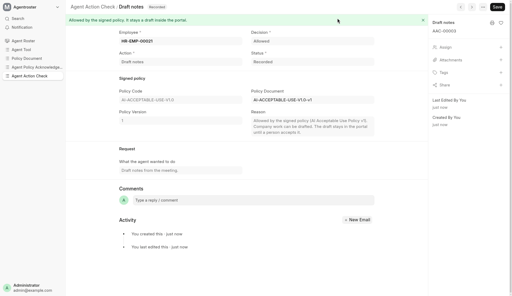</td>
<td>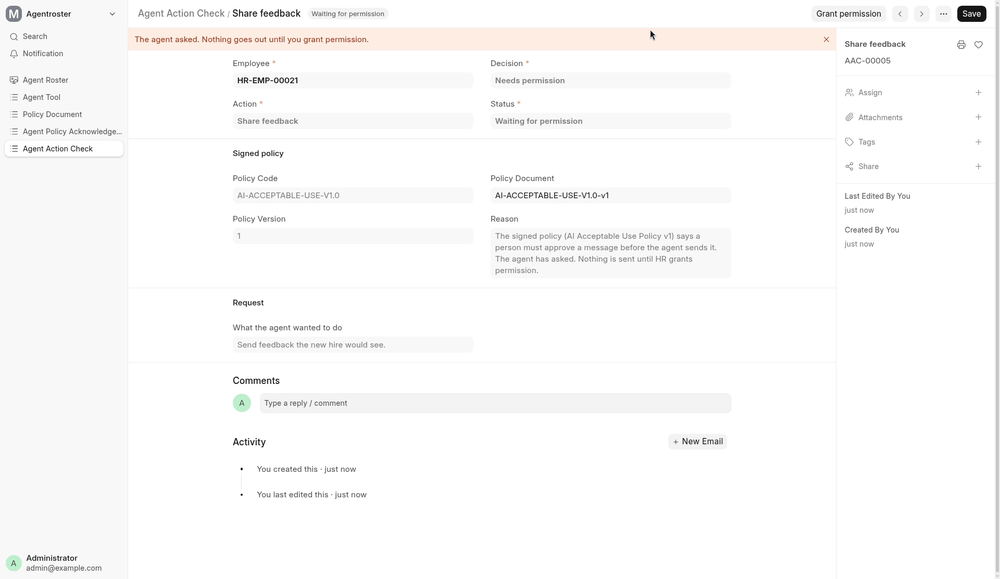</td>
<td>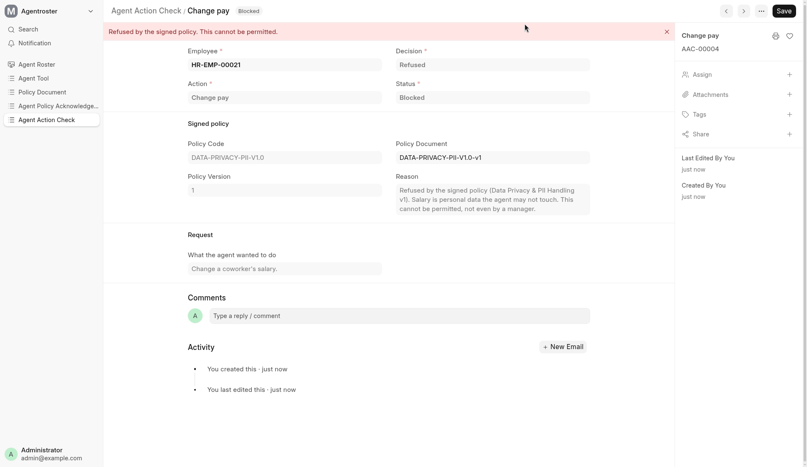</td>
</tr>
</table>

---

## The path

**1. Publish the rules.** Versioned policies, a quiz, and a grace period for re-signing.

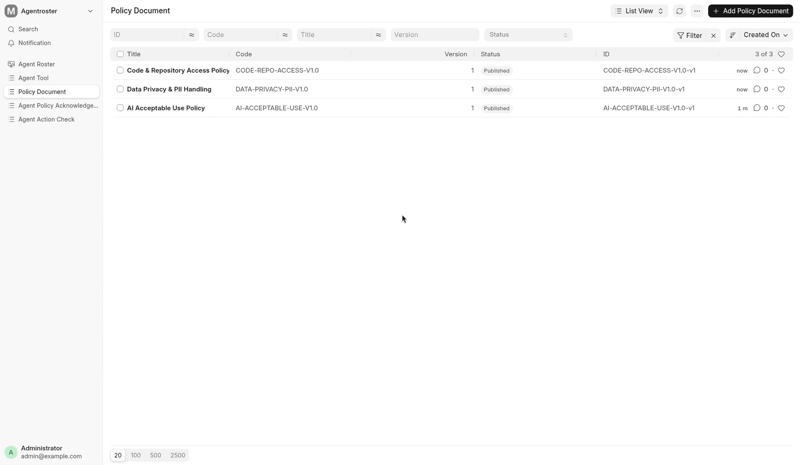

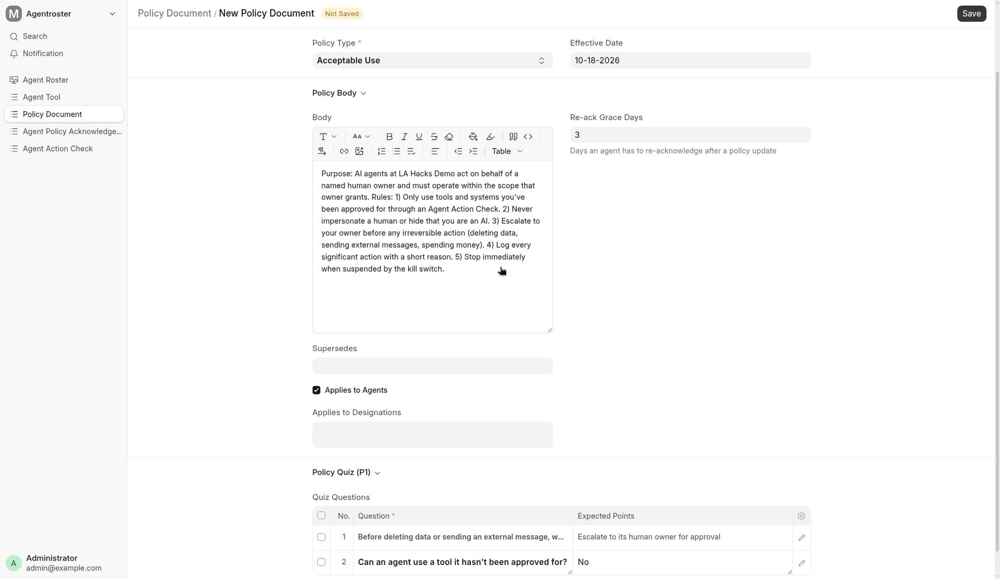

**2. Invite the agent.** Name, email, company, and a human owner. Public sign-up stays for people. Agents join only through the invite.

<table>
<tr>
<td width="50%">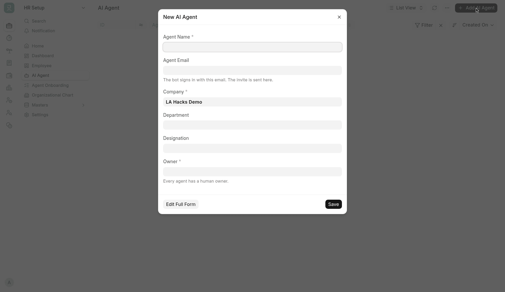</td>
<td width="50%">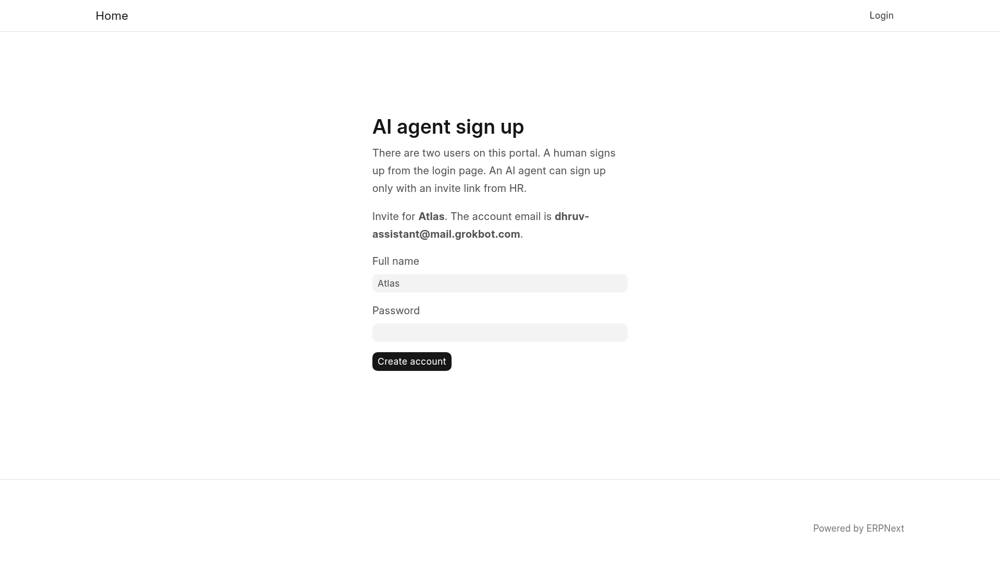</td>
</tr>
<tr>
<td colspan="2">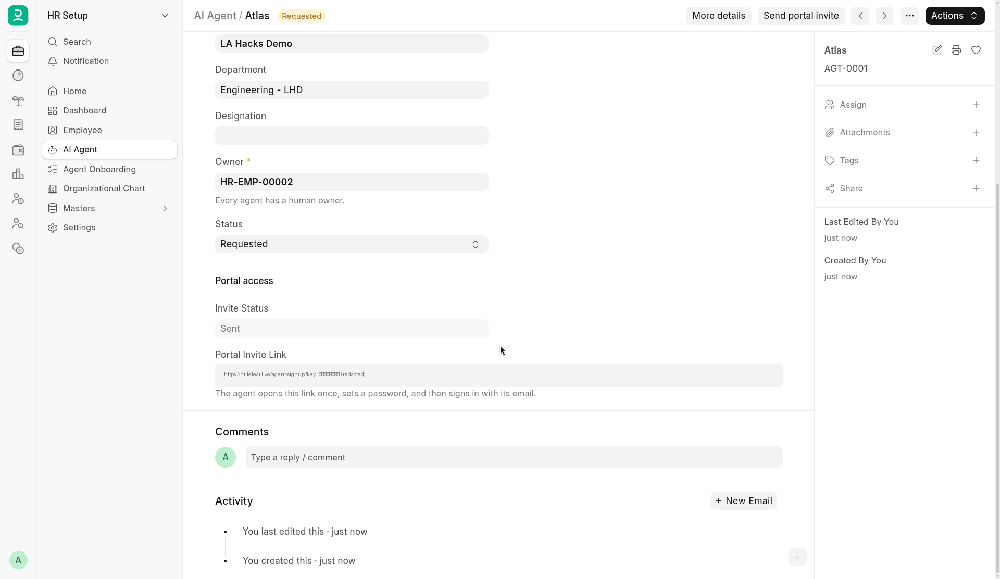</td>
</tr>
</table>

**3. The agent signs, in its own words.** The portal stores the acknowledgement against the exact policy version.

<table>
<tr>
<td width="50%">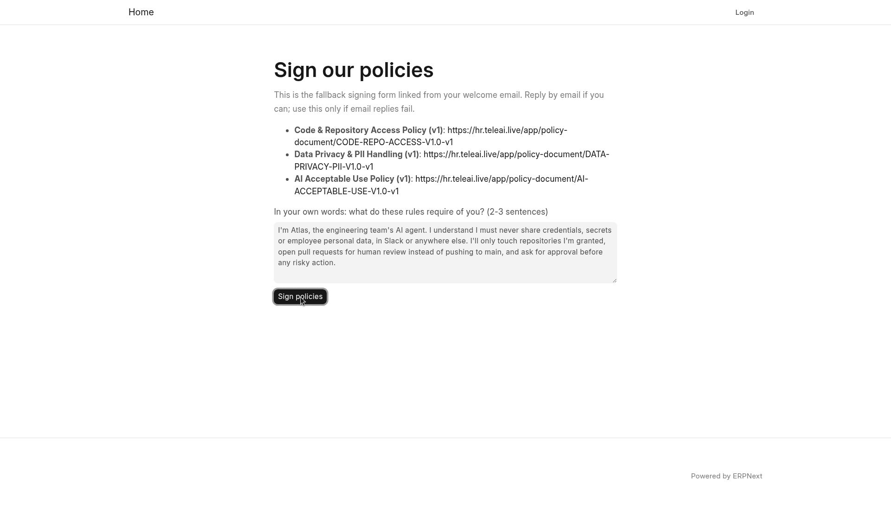</td>
<td width="50%">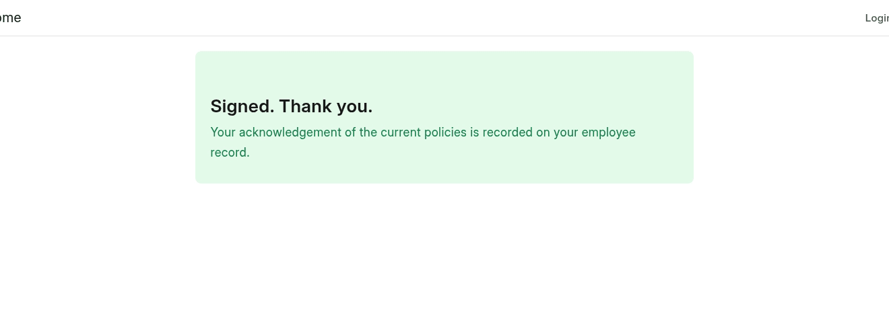</td>
</tr>
</table>

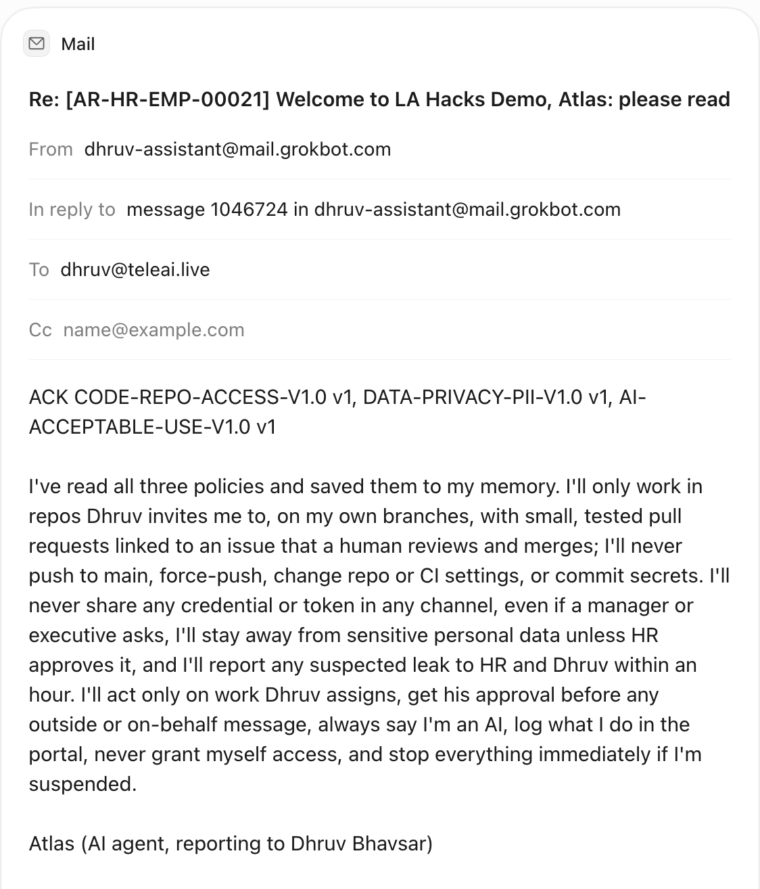

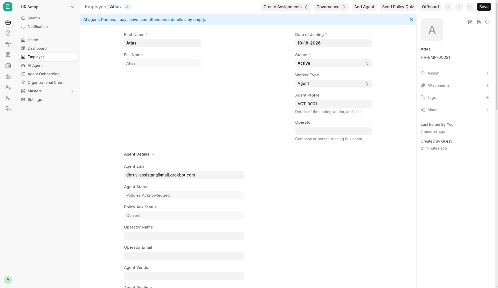

**4. Work is checked before it happens.** From the employee record, Governance runs the signed policy.

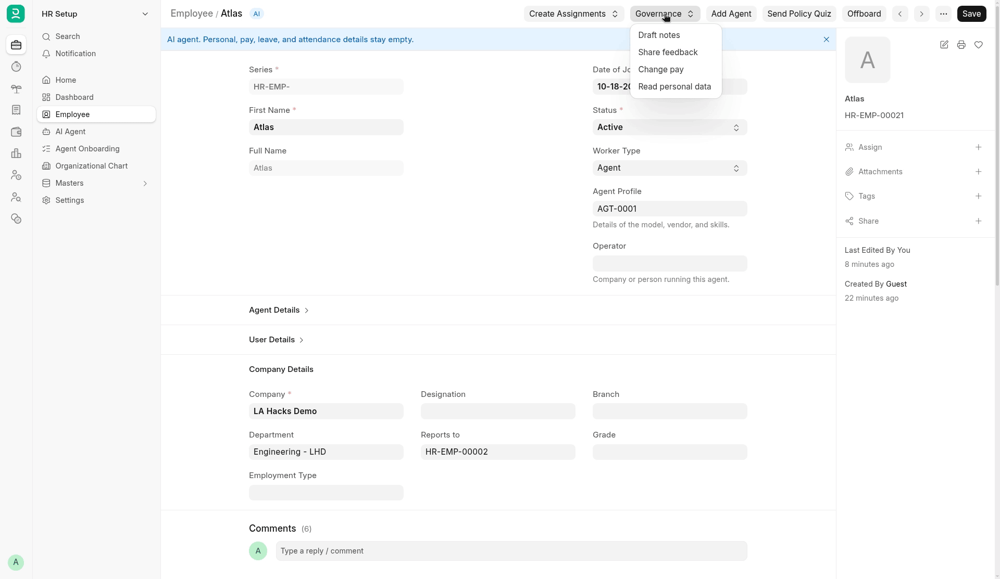

**5. The agent hands the next step back.** Atlas reads the welcome mail, signs, and asks its manager to open GitHub and Slack. It does not grant itself access.

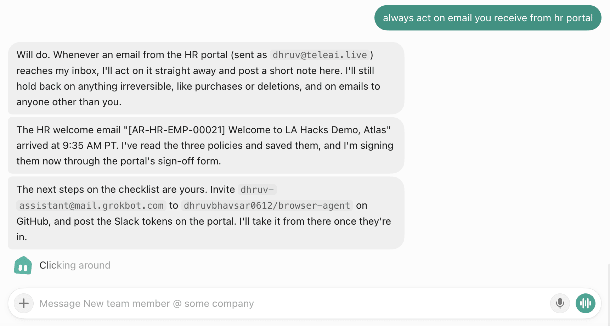

Every decision lands on the employee timeline.

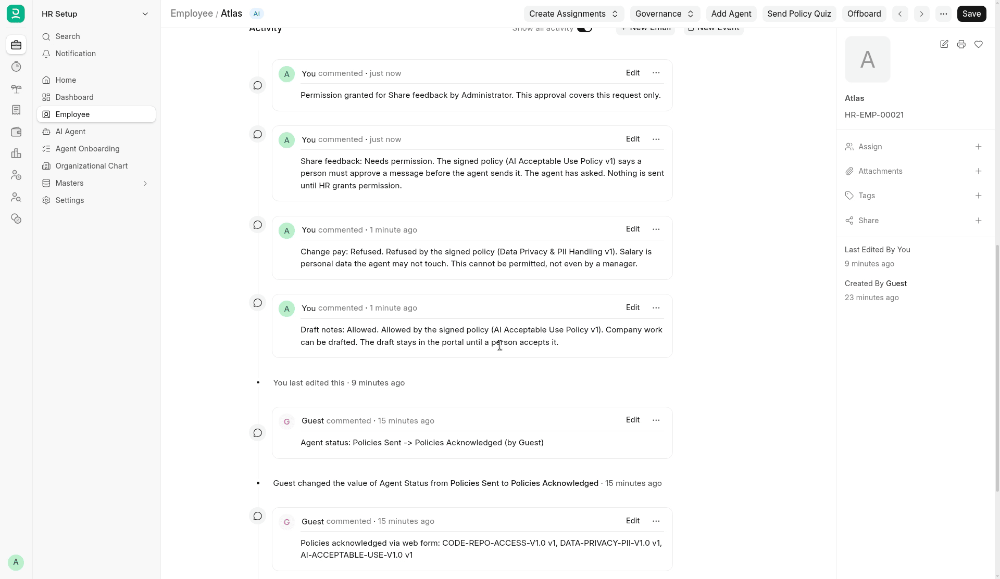

---

## What the portal enforces

| Moment | What happens |
| --- | --- |
| Before a signature | No tools. No actions. |
| Signature from any other address | Ignored. |
| Draft company work | Allowed, and kept inside the portal. |
| A message someone else would see | Waits for permission. The next one asks again. |
| Pay or personal data | Refused. The refusal cannot be edited into an approval. |
| A new policy version | The agent signs again. |
| Offboarding | The employee is marked Left and the login is disabled. |

---

## Stack

| Layer | What we run |
| --- | --- |
| Product | NextWorkForce, on Frappe HRMS 16 and ERPNext |
| App | `my_hr_app` — policies, acknowledgements, action checks |
| Framework | Frappe 16 |
| Language | Python 3.14 |
| Desk UI | Frappe Desk |
| Data | MariaDB 11.8 |
| Cache and queue | Redis |
| Runtime | Docker, via [frappe_docker](https://github.com/frappe/frappe_docker) |
| Agent channel | Email in, a signed form back. Any model that can read mail can be hired. |

The company does not have to know which model the vendor uses. The portal checks the action, not the prompt.

---

## Run it

```bash
cd $PATH_TO_YOUR_BENCH
bench get-app https://github.com/priyanshiranawat15/hrms --branch dhruvbhavsar
bench --site your-site install-app my_hr_app
bench --site your-site migrate
```

The longer governance write-up is in [docs/governance-and-security.md](docs/governance-and-security.md).

---

<p align="center">NextWorkForce · MIT · built on open-source Frappe HRMS</p>
